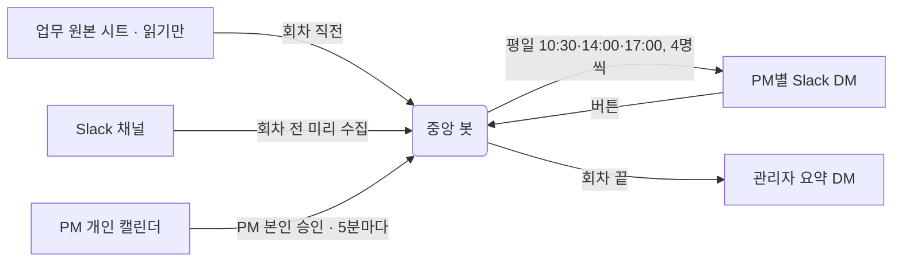

# 슬랙 봇 개인 업무 비서

> PM이 업무 시트 · Slack · 캘린더를 따로 열어 보지 않아도,
> **오늘 내가 할 일**을 평일 **10:30 · 14:00 · 17:00**에 개인 Slack DM으로 받습니다.

Google Apps Script와 Slack Web API만 씁니다. 유료 AI나 외부 자동화 도구는 쓰지 않습니다.

## 현재 기준 · 2026-11-24

| 항목 | 상태와 근거 |
| --- | --- |
| 기본 기능 | 업무 시트·Slack·본인 승인 캘린더를 개인 DM으로 안내. 평일 10:30·14:00·17:00 |
| 판소리 추가 | 설정된 스레드와 수신자만 연결. 본인 요청·공통 안내·담당 설명과 기한 보존 |
| 자동 판단 제한 | 같은 스레드 활동으로 답장·완료를 판정하거나 요청을 숨기지 않음 |
| 최근 검증 | 전체 40개 테스트 통과. 11/24 17:54 운영 업로드 후 8파일 일치 확인 |
| 실제 확인 범위 | 사용자 로그로 판소리 읽기·저장·통합 미리보기 확인. 후속 정책 DM 수신은 별도 확인 |
| 과거 운영 수치 | 11/02 14:00 회차 18/18 수신 기록. 현재 인원·성능을 새로 측정한 수치가 아님 |

처음 보는 분은 [구조와 흐름](docs/01_구조와흐름.md), 운영자는 [빠른 시작](docs/00_운영자빠른시작.md), 판소리 담당자는 [현재 운영 안내](docs/PANSORI_SETUP.md)를 참고한다.

## 하루 세 번, 무엇을 받나

| 시각 | 이름 | 들어가는 것 |
| --- | --- | --- |
| **10:30** | 오전 브리핑 | 오늘 업무 · 오늘 회의 · Slack 요청 · 점심 추천 · 오늘의 한마디 |
| **14:00** | 오후 업데이트 | 오전 이후 **새로 생긴** 업무·Slack + 남은 회의 (새 소식이 없으면 한 줄 인사) |
| **17:00** | 마무리 브리핑 | 업무 · 남은/내일 회의 · Slack · 내일 날씨 |

요일별로 더 붙는 것: 월요일 오전 `이번 주 종료 예정`, 목·금 저녁 주말 인사, 금요일 저녁 `다음 주 초 미리보기`.

### DM 예시 (가상)

```text
☀️ PM A 님, 10/26(월) 오전 브리핑 드립니다!
──────────
📌 오늘 확인할 업무
• 언어쌍 종료 임박 3건 — 남은 작업·종료 일정 확인
• 어뷰저 관리 2건 · 작성 기한: 10/26 (오늘)
   ↳ 관련 Slack · 작성자B [이번 주 어뷰저 리스트 작성 요청]
[ ✅ 완료 ]                                   ← 누르면 오늘 남은 DM에서 빠짐
──────────
📅 오늘 회의
• 15:00 리뷰 · 응답 전
• ⚠️ 회의 겹침: 15:00 리뷰 ↔ 15:30 주간 회의
──────────
💬 Slack
• NAC Scrum · 회의록 작성 · 원문 10/26
   ↳ 작성자C · [Scrum 일정 안내 및 회의록 작성 요청]
업무·회의 10:31 · Slack 10:25 기준   ← 회색 작은 글씨
──────────
🍚 점심 추천
• 예시식당 — 추천 메뉴: 제육볶음, 김치찌개
• 가볍게 · 예시카페 — 추천 메뉴: 아메리카노, 샌드위치
🤝 오늘 예시식당 메이트: PM D 님 — 같이 가볼까요?
[ 점심 메이트 끄기 ]
──────────
✨ 오늘의 한마디
> 작은 한 칸도 진전으로 세어봐요.
[ 👍 도움됐어요 ] [ 👎 아쉬워요 ] [ ✍️ 자세히 남기기 ]
```

## 기능 한눈에

| 영역 | 무엇을 | 어떻게 정하나 |
| --- | --- | --- |
| 📌 업무 | 종료 임박·신규 유저 검토·헤즈업·어뷰저·1차 검수·테스트지 (6종) | 원본 시트의 담당자·상태·날짜. 항목마다 원문 링크 |
| 💬 Slack | 나를 직접 멘션했거나 PM 그룹으로 멘션한 글 | 최근 7일 중 아직 안 보여 준 글. 오늘 기한·당일 요청은 그날 다시 |
| 📅 회의 | 내 개인 일정 + 공유 캘린더에서 내가 초대됐거나 만든 일정 | PM이 연결 앱에서 **본인 계정으로 승인**해야 보임 |
| 🍚 점심 | 식당 1곳 + 가벼운 곳 1곳(추천 메뉴 최대 2개), 점심 메이트 | 어제와 다른 음식 묶음에서 고름. 메이트는 버튼으로 켠 사람 중 실제 DM 수신자끼리만, 3명당 1곳 |
| ✅ 버튼 | 업무 완료 · 점심 메이트 · 피드백 | 누른 본인에게만 적용. 원본 시트는 바꾸지 않음 |
| 🧭 관리자 | 회차마다 요약 DM 1통 | 발송 결과 · 확인할 PM과 원인 · 처리 시간 · 저장 공간 |

**안전 원칙**
- 원본 업무 시트는 **읽기만** 합니다. 봇이 쓰는 곳은 봇 전용 시트뿐입니다.
- 애매하면 추측하지 않고 "원문 확인"으로 남깁니다.
- 한 PM의 명단 문제나 시트 하나의 읽기 실패로 전체 발송이 멈추지 않습니다. 그 부분만 빠지고 관리자 요약에 이유가 나옵니다.

## 어떻게 동작하나



| 구성 | 하는 일 |
| --- | --- |
| **중앙 봇** (Apps Script 프로젝트 1) | 시트를 읽고, Slack을 분류하고, 회의를 붙여 PM별 DM을 보냅니다 |
| **연결 앱** (Apps Script 프로젝트 2) | PM이 링크로 열어 본인 계정으로 승인하면 본인 회의만 중앙 봇에 보냅니다 |
| **봇 전용 시트** | 수신자(BOT_USERS) · 업무 후보(BOT_TASKS) · 발송 기록 · Slack 수집본 · 설정 · 피드백 |

## 어떤 문서를 볼까

| 이럴 때 | 문서 |
| --- | --- |
| 처음 인계받았다 / 오늘 DM이 이상하다 | [00 운영자 빠른 시작](docs/00_운영자빠른시작.md) |
| 데이터가 어디서 와서 DM이 되는지 궁금하다 | [01 구조와 흐름](docs/01_구조와흐름.md) |
| 매일 운영, 설정 바꾸기, PM 추가 | [02 운영 가이드](docs/02_운영가이드.md) |
| 코드를 고치고 올려야 한다 | [03 개발 가이드](docs/03_개발가이드.md) |
| 이 업무·Slack 글이 왜 DM에 나왔는지(안 나왔는지) | [04 기능과 판정 기준](docs/04_기능과판정기준.md) |
| 언제 무엇이 바뀌었는지 | [05 변경 기록](docs/05_변경기록.md) |
| "없음"이 정상인지 수집 실패인지 | [06 없음과 수집 실패 점검](docs/06_없음과수집실패점검.md) |
| 발표 PPT를 만든다 (Claude에게 "PPT 만들자") | [07 발표 자료](docs/07_발표자료.md) |
| 담당자가 바뀐다 / 인계한다 | [08 인계](docs/08_인계.md) |
| 계정·트리거·Slack 앱 설정 전체 목록, 계정이 갑자기 사라졌을 때 복구 | [09 운영 환경 스펙](docs/09_운영환경스펙.md) |
| 판소리 스레드 연결 설정 | [판소리 안내](docs/PANSORI_SETUP.md) |
| Slack을 언제·어떻게 읽어 봇 시트에 쌓는지, 스레드 목록 설정 방식 | [10 Slack 수집과 시트 적재](docs/10_슬랙수집과적재.md) |
| 편집기에서 실행할 함수 전체 | [함수 목록](docs/함수목록.md) (자동 생성) |

## 저장소 구성

| 폴더 | 내용 |
| --- | --- |
| [`src/central-bot/`](src/central-bot) | 중앙 봇 원본(번호 파일). 업로드할 때 7개 합본으로 묶습니다 ([묶음 표](src/central-bot/README.md)) |
| [`src/calendar-connector/`](src/calendar-connector) | 연결 앱(연결 화면 + 자동 갱신) |
| [`tests/`](tests) | Node.js 합성 테스트. 실제 Slack·Google을 부르지 않음 |
| [`tools/`](tools) | 테스트 실행, 합본 빌드, 함수 목록 생성 |
| [`docs/`](docs) | 문서 |

```bash
node tools/test-local.cjs          # 테스트 전체
node tools/build-apps-script.cjs   # 업로드용 합본 7개 → apps-script-deploy/
```

> **공개 데모본입니다.** 회사·채널·캘린더·식당 이름은 예시 값이고, 실제 운영 기록과 내부 문서는 넣지 않았습니다.
>
> 이 저장소는 공개용 사본입니다. 시트 ID·회사 도메인·Slack ID·사람 이름은 예시 값으로 바꿨고, 토큰·인증 파일·운영 기록은 넣지 않았습니다. 운영 프로젝트에 그대로 덮어쓰지 마세요.
