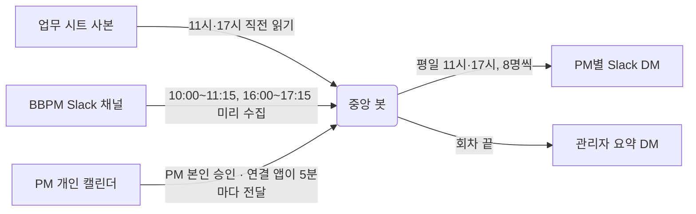

# 슬랙 봇 개인 업무 비서

PM마다 흩어져 있는 **업무 시트 · Slack 요청 · 캘린더 회의**를 모아, 평일 **11시와 17시**에 각자의 Slack DM으로 한 번에 알려 주는 봇입니다.
Google Apps Script와 Slack Web API만 사용합니다. 유료 AI나 외부 자동화 도구는 쓰지 않습니다.

## PM이 받는 DM (가상 예시)

```text
☀️ PM A 님, 10/23(금) 오전 브리핑 드립니다!
──────────
📌 오늘 확인할 업무
• 언어쌍 종료 임박 3건 — 남은 작업·종료 일정 확인
• 어뷰저 관리 2건 · 작성 기한: 10/23 (오늘) — 대상 확인·리스트 작성
   ↳ 관련 Slack [개인] 원문 10/23 · 기한 10/23(금) · 작성자B "이번 주 리스트 작성 부탁드립니다…"
──────────
📅 오늘 회의
• 16:00 주간 회의 · 응답 전
──────────
💬 Slack
오늘 기한
• [BBPM] HA-CV · 데이터 검수 · 기한 10/23(금) 퇴근 전 · 원문 10/22
   ↳ 작성자C "검수 대상 파일 확인 부탁드립니다…"
업무·회의 11:02 · Slack 10:52 기준          ← 회색 작은 글씨
──────────
🍚 점심 추천
• 예시식당 — 뜨끈한 국밥 한 그릇 어때요?
──────────
✨ 오늘의 한마디
> 작은 한 칸도 진전으로 세어봐요.
```

- 17시 DM은 "마무리 브리핑"으로, 오늘 남은 회의와 내일 회의를 보여 주고 점심 추천은 뺍니다.
- 업무·프로젝트·Slack 항목 글씨에는 원문 링크가 걸립니다.
- 관리자에게는 회차마다 발송 결과와 문제(할 일)를 요약한 DM이 한 통 더 갑니다.

## 어떻게 동작하나



| 구성 | 하는 일 |
| --- | --- |
| **중앙 봇** (Apps Script 프로젝트 1) | 업무 시트를 읽고, Slack 수집본을 분류하고, 회의를 붙여 PM별 DM을 보냅니다. |
| **연결 앱** (Apps Script 프로젝트 2) | PM이 링크로 열어 **본인 Google 계정으로 승인**합니다. 본인 캘린더에서 본인이 참석하거나 만든 회의만 중앙 봇에 보냅니다. |
| **봇 전용 시트** | 업무 후보(BOT_TASKS), 수신자(BOT_USERS), 발송 기록, Slack 수집본을 저장합니다. 원본 업무 시트에는 쓰지 않습니다. |

## 저장소 안내

| 폴더 | 내용 |
| --- | --- |
| [`src/central-bot/`](src/central-bot) | 중앙 봇 원본 23개 파일. 번호는 기능 단위이고, 업로드할 때 7개 파일로 합칩니다. ([묶음 표](src/central-bot/README.md)) |
| [`src/calendar-connector/`](src/calendar-connector) | 연결 앱(웹 화면 + 자동 갱신) |
| [`tests/`](tests) | Node.js 합성 테스트. 실제 Slack·Google 호출 없음 |
| [`tools/`](tools) | 테스트 실행, Apps Script 합본 빌드, 함수 목록 생성 |
| [`docs/`](docs) | 문서 |

## 문서

| 문서 | 이런 때 보세요 |
| --- | --- |
| [01 구조와 흐름](docs/01_구조와흐름.md) | 데이터가 어디서 와서 어떻게 DM이 되는지 |
| [02 운영 가이드](docs/02_운영가이드.md) | 매일 운영, 상황별로 실행할 함수, 문제 해결 |
| [03 개발 가이드](docs/03_개발가이드.md) | 코드 고치기 → 테스트 → 빌드 → 업로드 순서와 규칙 |
| [04 기능과 판정 기준](docs/04_기능과판정기준.md) | 어떤 업무·Slack 글·회의를 DM에 넣는지 |
| [05 변경 기록](docs/05_변경기록.md) | 날짜별 변경과 확인 수준 |
| [함수 목록](docs/함수목록.md) | 편집기에서 직접 실행하는 함수 전체 (자동 생성) |

## 빠른 시작 (개발)

```bash
node tools/test-local.cjs          # 합성 테스트 전체
node tools/build-apps-script.cjs   # Apps Script 업로드용 합본 7개 생성 → apps-script-deploy/
```

> **공개 데모본입니다.** 회사·채널·캘린더·식당 이름은 예시 값이고, 실제 운영 기록과 내부 문서는 넣지 않았습니다.
>
> 이 저장소는 공개용 사본입니다. 시트 ID·회사 도메인·Slack ID·사람 이름은 예시 값으로 바꿨고, 토큰·인증 파일·운영 기록은 넣지 않았습니다. 운영 프로젝트에 그대로 덮어쓰지 마세요.
