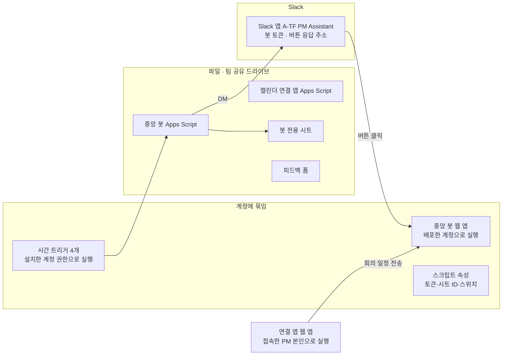

# 09. 운영 환경 스펙 (코드 밖에 있는 것)

코드와 문서는 저장소에 다 있지만, 봇이 실제로 돌려면 **계정에 묶인 설정**이 더 필요합니다. 이 문서는 그 설정을 빠짐없이 적은 목록입니다. 값(토큰·주소·ID)은 적지 않고 **이름, 하는 일, 어디서 확인하는지**만 적습니다.

쓰는 때:
- **정상 인계:** [08 인계](08_인계.md)의 3~5단계를 할 때 체크리스트로 씁니다.
- **갑작스러운 계정 삭제:** 기존 담당자 계정이 인계 전에 사라졌을 때 [5. 처음부터 다시 세우기](#5-처음부터-다시-세우기-계정이-갑자기-사라졌을-때)를 따릅니다.
- **다른 팀에 같은 봇을 만들 때:** 이 문서가 환경 요구사항(스펙)입니다.

## 1. 구성 한눈에 보기

| 구성 요소 | 계정이 사라지면 | 인계 방법 |
| --- | --- | --- |
| 시간 트리거 4개 | **즉시 멈춤** (설치한 계정 권한으로 돎) | 후임자 계정에서 다시 설치 |
| 중앙 봇 웹 앱 | **버튼(완료·메이트·피드백)과 캘린더 수신이 멈춤** (배포한 계정으로 실행) | 후임자가 같은 배포 ID로 재배포 |
| 연결 앱 웹 앱 | 영향 적음 (접속한 PM 본인 계정으로 실행) | 같은 배포 ID 유지 |
| 스크립트 속성 | 남음 (프로젝트에 저장) | 계정 관련 값 2개만 변경 |
| 파일 4개 | 남음 (공유 드라이브) | 없음 |
| Slack 앱 | 앱·토큰은 남지만 **관리할 사람이 없어짐** | 후임자를 협업자로 추가 |
| Git 저장소 | 개인 GitHub 계정에 있음 | 협업자 추가 또는 회사 계정으로 이전 |
| 노션 기록 | 워크스페이스 종류에 따라 다름 | 회사 워크스페이스로 옮기거나 후임자 초대 |

## 2. 시간 트리거

| 트리거 | 함수 | 주기 | 설치 함수 |
| --- | --- | --- | --- |
| Slack 미리 수집 | `collectBbpmSnapshot` | 10분마다 깨어나서 09:45~10:45 · 13:30~14:15 · 16:00~17:15에만 수집 | `installBbpmCollectTrigger` |
| 오전 브리핑 | `sendScheduledBriefing11` | 매일 10:30 근처(±15분), 평일만 발송 | `installBriefingTriggers` |
| 오후 업데이트 | `sendScheduledBriefing14` | 매일 14:00 근처 | `installBriefingTriggers` |
| 마무리 브리핑 | `sendScheduledBriefing17` | 매일 17:00 근처 | `installBriefingTriggers` |
| (자동) 이어 보내기 | `resumeConnectedBriefingSend` | 회차가 6분을 넘으면 스스로 1회용 트리거를 만듦 | 직접 설치하지 않음 |
| (연결 앱) 회의 갱신 | `syncMyMeetings` | PM 각자 계정에서 5분마다 | PM이 연결할 때 자동 |

- 확인: 중앙 봇에서 `previewBriefingAutomationStatus` (트리거 수·마지막 수집 시각, 읽기만).
- 지우기: 정기 DM 3개는 `removePersonalBriefingTriggers`. 수집 트리거는 Apps Script 트리거 화면에서 지웁니다.
- 같은 트리거가 두 계정에 있으면 **두 번 발송**됩니다. 지우기 → 설치 순서를 지킵니다.

## 3. 스크립트 속성 (중앙 봇)

값은 Apps Script 프로젝트 설정 → 스크립트 속성에 있습니다. 대부분은 봇 시트 BOT_SETTINGS에 적고 `applyBotSettings`로 반영합니다(반영 후 B열이 비는 것은 정상).

### 꼭 있어야 하는 것

| 이름 | 하는 일 | 계정 바뀔 때 |
| --- | --- | --- |
| `SLACK_BOT_TOKEN` | Slack 봇 토큰(xoxb-). DM 발송·Slack 읽기 | 앱 재설치 시에만 |
| `SLACK_VERIFICATION_TOKEN` | Slack 버튼 요청이 진짜인지 확인 | 그대로 |
| `BOT_SPREADSHEET_ID` | 봇 전용 시트 | 그대로 |
| `SOURCE_SPREADSHEET_ID`, `PM_REVIEW_SPREADSHEET_ID`, `TEST_MANAGEMENT_SPREADSHEET_ID` | 원본 업무 시트(읽기만) | 그대로 |
| `CONNECTOR_SIGNING_KEY` | 연결 앱 ↔ 중앙 봇 서명 키(양쪽 같은 값) | 그대로 |
| `CALENDAR_CONNECT_URL` | PM에게 보내는 연결 앱 주소 | 연결 앱 주소가 바뀔 때만 |
| `SLACK_PM_GROUP_ID`, `SLACK_ROSTER_GROUP_IDS` | PM 그룹(멘션 판정·명단 동기화) | 그대로 |
| **`BRIEFING_EXECUTOR_EMAIL`** | 발송을 허용할 실행 계정. 다른 계정이 돌리면 막음 | **후임자 계정으로 (`pinBriefingExecutor`)** |
| **`PILOT_PM_NAME`** | 관리자 요약·시험 DM을 받을 사람 | **후임자 이름으로** |

### 기능 스위치 (`true`/`false`)

| 이름 | 켜면 |
| --- | --- |
| `ENABLE_PM_SEND`, `ENABLE_CONNECTED_PM_SEND` | 정기 DM 발송 |
| `ENABLE_SELF_CALENDAR_PIPELINE`, `ENABLE_CALENDAR_BRIEFING`, `ENABLE_CALENDAR_SELF_ENROLLMENT` | 캘린더 연결·회의 표시 |
| `ENABLE_SLACK_MENTION_READ`, `ENABLE_SLACK_CHANNEL_DISCOVERY` | Slack 수집 |
| `ENABLE_PANSORI_READ` (+ `PANSORI_RECIPIENT_IDS`) | 판소리 스레드 수집·표시 ([판소리 안내](PANSORI_SETUP.md)) |
| `ENABLE_LUNCH_RECOMMENDATION`, `ENABLE_LUNCH_MATE` | 점심 추천·메이트 버튼 |
| `ENABLE_BRIEFING_PHRASES` | 오늘의 한마디(10:30만) |
| `ENABLE_WEATHER` (+ `WEATHER_LAT`, `WEATHER_LON`, `WEATHER_PLACE`) | 17:00 내일 날씨 |
| `ENABLE_TASK_DONE`, `ENABLE_FEEDBACK` (+ `FEEDBACK_FORM_URL`) | 완료 버튼·피드백 버튼 |
| `ENABLE_PERSONAL_LEAVE_SKIP` | 본인 종일 연차면 DM 쉼 |
| `ENABLE_WORKLOG_BRIEFING` (+ `WORKLOG_SPREADSHEET_ID`) | 업무일지 칸 |

### 그 밖의 설정

`COMPANY_HOLIDAYS`(회사 휴무일), `SLACK_MENTION_LOOKBACK_DAYS`, `SLACK_SNAPSHOT_MAX_AGE_MINUTES`, `SLACK_DISCOVERY_CHANNEL_ID`, `SLACK_MENTION_THREADS`, `SLACK_AUTHOR_NAMES`, `CALENDAR_INVITE_PM_NAMES`.

### 봇이 스스로 쓰는 상태값 (손대지 않음)

`BBPM_COLLECT_*`, `BBPM_DISCOVERY_CHECKPOINT`, `CONNECTED_SEND_JOB`, `CONNECTED_SEND_REQUEST`, `BOT_TASKS_REFRESHED`, `ROUTE_ISSUES`, `SLACK_POST_NOT_BEFORE`, `LUNCH_CHOICE_*`, `LUNCH_MATE_*`, `BRIEFING_PHRASE_*`, `CALENDAR_ONBOARDING_READY`, `COPY_SHEETS_BACKUP` 등. 지우면 재발송·중복 같은 문제가 생길 수 있습니다.

### 연결 앱 속성

`CONNECTOR_RECEIVER_URL`(중앙 봇 웹 앱 주소), `CONNECTOR_SIGNING_KEY`(중앙 봇과 같은 값), `CONNECTOR_ALLOWED_DOMAIN`(회사 도메인). 나머지(`CONNECTED`, `SYNC_STATE` 등)는 PM별 상태라 손대지 않습니다.

## 4. 권한과 배포

### Google 권한 (appsscript.json)

| 프로젝트 | 권한 | 웹 앱 |
| --- | --- | --- |
| 중앙 봇 | 시트, 외부 요청(Slack·날씨), 트리거, 캘린더 읽기, 이메일 확인 | **배포한 계정으로 실행**, 누구나 접근(Slack 서버가 호출하므로) |
| 연결 앱 | 캘린더 읽기, 트리거, 이메일 확인, 외부 요청 | **접속한 사용자로 실행**, 회사 도메인만 접근 |

- 웹 앱 배포는 **항상 같은 배포 ID로** 새 버전을 올립니다: `clasp deploy -i <기존 배포 ID>`. 배포 ID 목록은 `clasp deployments`로 확인합니다.
- 연결 앱 프로젝트는 회사 도메인 전체에 **보기** 공유가 되어 있어야 PM이 연결할 수 있습니다.

### Slack 앱 설정

| 항목 | 값 |
| --- | --- |
| 봇 토큰 권한 | `chat:write`(DM), `channels:history`·`groups:history`(스레드 읽기), `channels:read`, `users:read`, `users:read.email`, `usergroups:read`(명단 동기화) |
| Interactivity Request URL | 중앙 봇 웹 앱 주소(버튼 응답) |
| 채널 | 봇을 읽을 채널(BBPM, 판소리)에 초대 |
| 앱 이름 | A-TF PM Assistant |

- 사용 중인 API: `chat.postMessage`, `conversations.history`, `conversations.replies`, `conversations.info`, `users.info`, `usergroups.users.list`, `auth.test`.
- 권한 확인: `previewRosterFromSlack`가 실제 부여된 권한을 로그에 보여줍니다.
- 권한을 추가하면 앱을 재설치해야 하고, 재설치하면 토큰이 바뀔 수 있습니다 → BOT_SETTINGS로 다시 반영.

## 5. 처음부터 다시 세우기 (계정이 갑자기 사라졌을 때)

트리거와 중앙 봇 웹 앱이 멈춘 상태입니다. 파일·속성·봇 시트는 공유 드라이브에 남아 있으므로 **다시 연결만** 하면 됩니다. 업로드 금지 시간(10:15~11:10 · 13:45~14:40 · 16:45~17:40)을 피합니다.

1. **파일 확인:** 팀 공유 드라이브 `A-TF PM Assistant` 폴더에 중앙 봇·연결 앱·봇 시트·피드백 폼이 있는지 봅니다. 후임자에게 편집 권한을 줍니다.
2. **실행 계정 고정:** 후임자가 중앙 봇을 열고 `pinBriefingExecutor` 실행(처음이면 권한 승인).
3. **관리자 지정:** BOT_SETTINGS에 `PILOT_PM_NAME` = 후임자 이름 → `applyBotSettings`.
4. **중앙 봇 웹 앱 재배포:** 후임자 계정에서 기존 배포 ID로 새 버전 배포. 실행 사용자가 후임자로 바뀝니다. 주소가 같으므로 Slack·연결 앱은 손댈 필요가 없습니다.
   - 기존 배포를 수정할 수 없으면 새 배포를 만들고 **세 곳을 새 주소로** 바꿉니다: Slack 앱 Interactivity Request URL, 연결 앱 속성 `CONNECTOR_RECEIVER_URL`, (연결 앱 주소가 바뀌었다면) 중앙 봇 `CALENDAR_CONNECT_URL`.
5. **트리거 설치:** `installBbpmCollectTrigger` → `installBriefingTriggers`.
6. **Slack 앱:** 후임자를 협업자로 추가합니다. 협업자가 아무도 없으면 Slack 워크스페이스 관리자에게 요청합니다. 그래도 안 되면 새 앱을 만들고 4절 권한으로 설치 → 새 토큰을 BOT_SETTINGS `SLACK_BOT_TOKEN`으로 반영 → 봇을 채널에 초대 → Verification Token도 다시 반영.
7. **확인:** `previewBriefingHealth`(실행 계정·설정 점검) → `previewBriefingAutomationStatus`(트리거 4개) → 다음 정기 회차의 관리자 요약 DM.
8. **PM 쪽:** 캘린더 연결은 PM 본인 계정 기준이라 다시 할 필요가 없습니다. 연결 앱 주소가 바뀌었을 때만 다시 초대합니다.

## 6. 퇴사 전 체크리스트

- [ ] 후임자 정함, 후임자가 공유 드라이브 폴더 편집 가능
- [ ] [08 인계](08_인계.md) 3단계: 트리거 이전(지우기 → 후임자 설치), `pinBriefingExecutor`, `PILOT_PM_NAME`
- [ ] 4단계: 중앙 봇·연결 앱 웹 앱을 후임자 계정에서 같은 배포 ID로 재배포
- [ ] 5단계: Slack 앱 협업자에 후임자 추가
- [ ] GitHub 비공개 저장소에 후임자 협업자 추가(또는 회사 계정으로 이전)
- [ ] 노션 기록을 회사 워크스페이스로 이동하거나 후임자 초대
- [ ] 세 회차 연속 관리자 요약이 후임자에게 정상 도착
- [ ] 위 확인 후 기존 담당자 권한 정리
